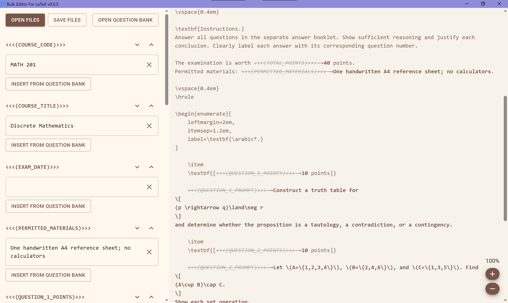
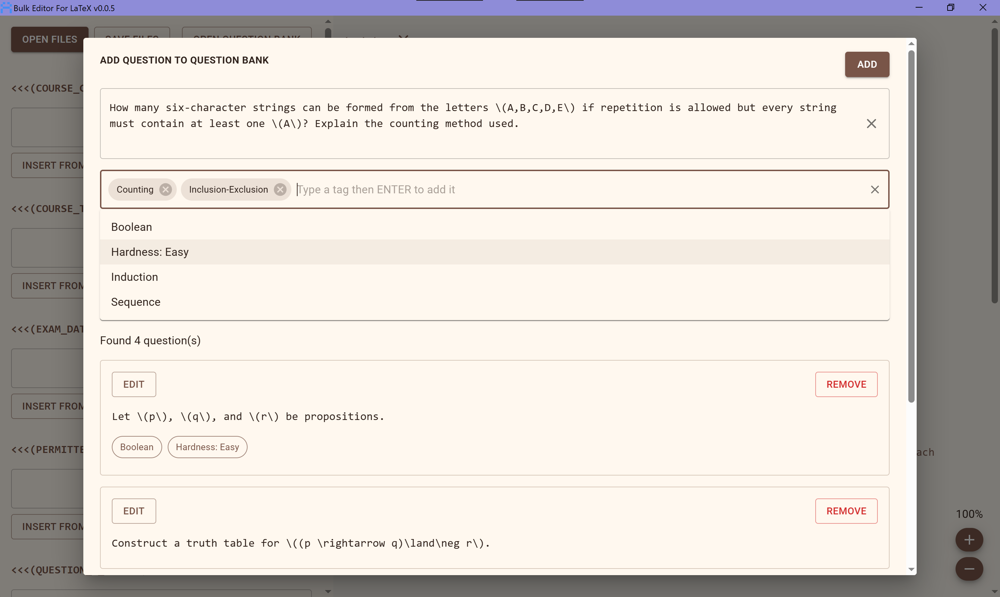
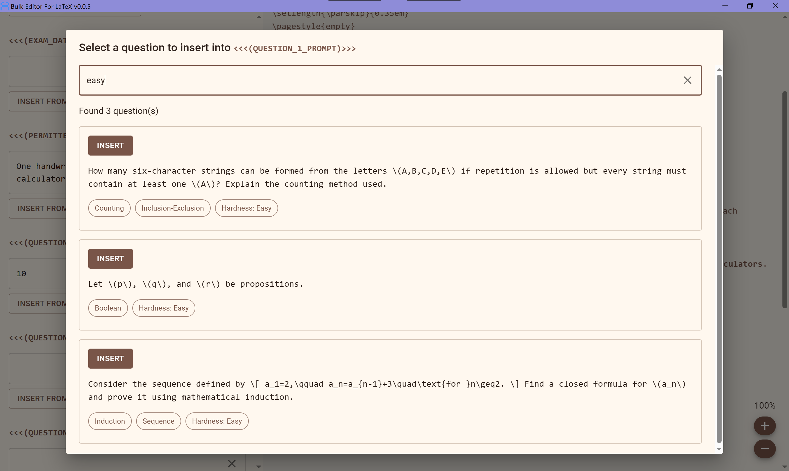
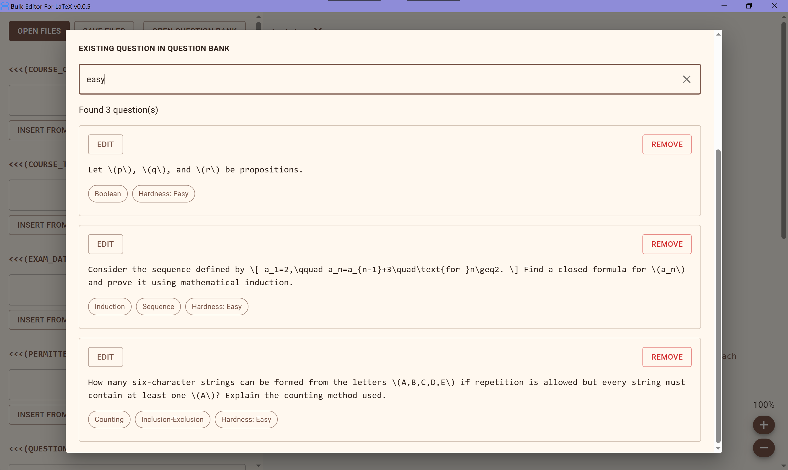

> No-nonsesne bulk editor for LaTeX documents.

# ~Project AMETRINE

Ametrine communicates via _placeholder markers_. These are a piece of text that satisfies the form `<<<(non-empty placeholder name)>>>` (read aloud as; less than symbol, less than symbol, less than symbol, open parenthesis, _placeholder name of your choice_, close parenthesis, greater than symbol, greater than symbol, greater than symbol.)

Opening a document with a _placeholder marker_ will allow you replace it with a text of your choosing.

> **Tips:** A document may contain more than one _placeholder markers_, and a _placeholder marker_ can appear more than once in a document, in such cases, all occurences will be replaced together.

## ~Question Banks

This simple system allows for a fun, but incredible, side effect - _question banks_.

### ~Adding a New Question

> **Tips:** Clicking the "**OPEN QUESTION BANK**" will open the following dialog where you can add, edit, or remove questions in your question bank.

> **Tips:** You can add tags to your questions to make it easier to search for them. You can add new tags or use previous tags you have added before.

### ~Inserting a Question from the Question Bank

> **Tips:** Pressing the "**INSERT FROM QUESTION BANK**" will open a dialog where you can search your question bank for a question, and insert it into the chosen _placeholder marker_.

### ~Searching the Question Bank

> **Tips:** Type in the searchbar to find a specific question. You can search by the tags or the content of the question itself.

